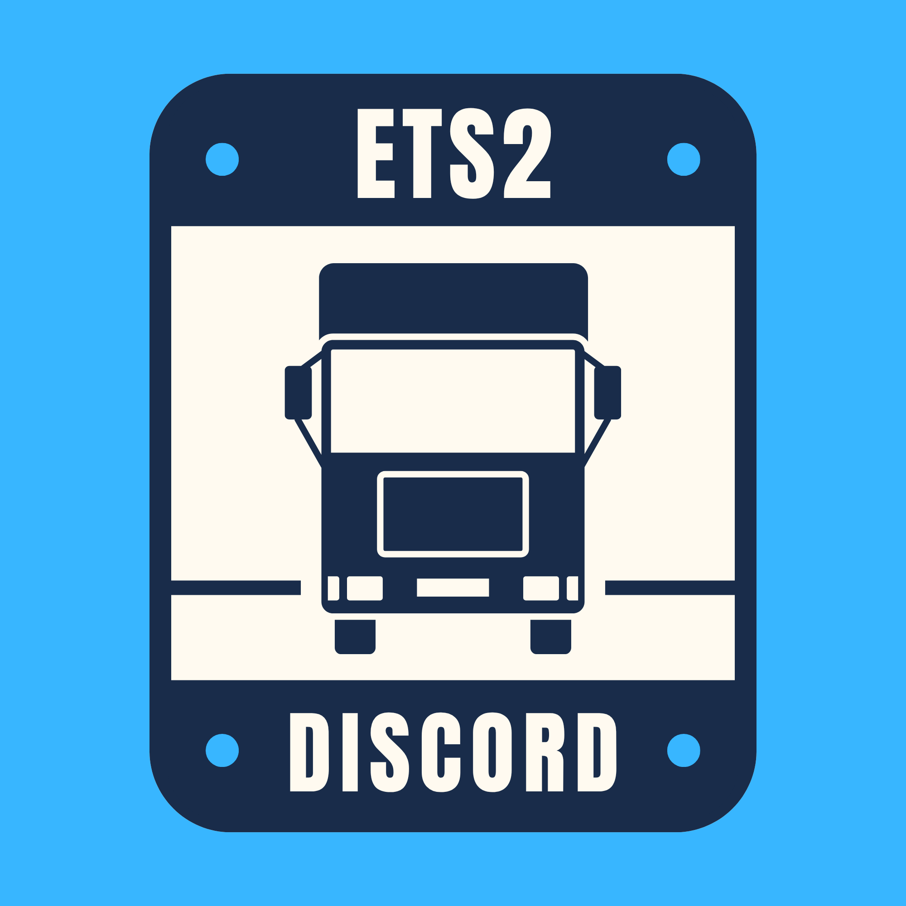
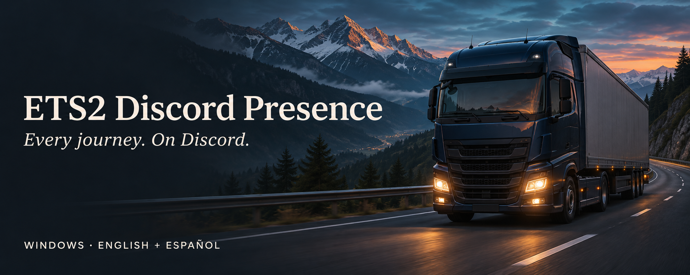
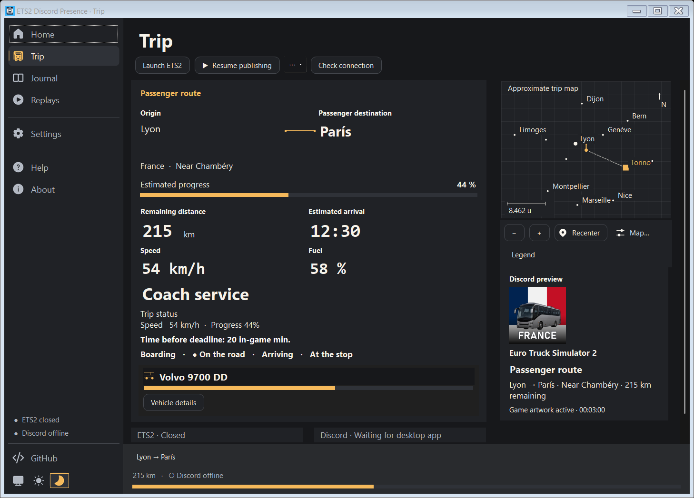
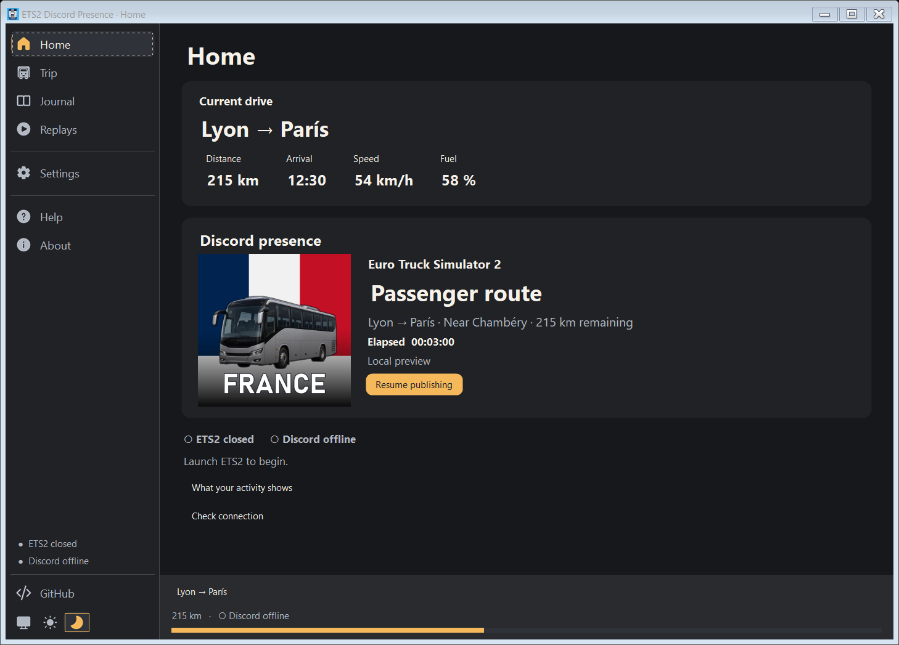
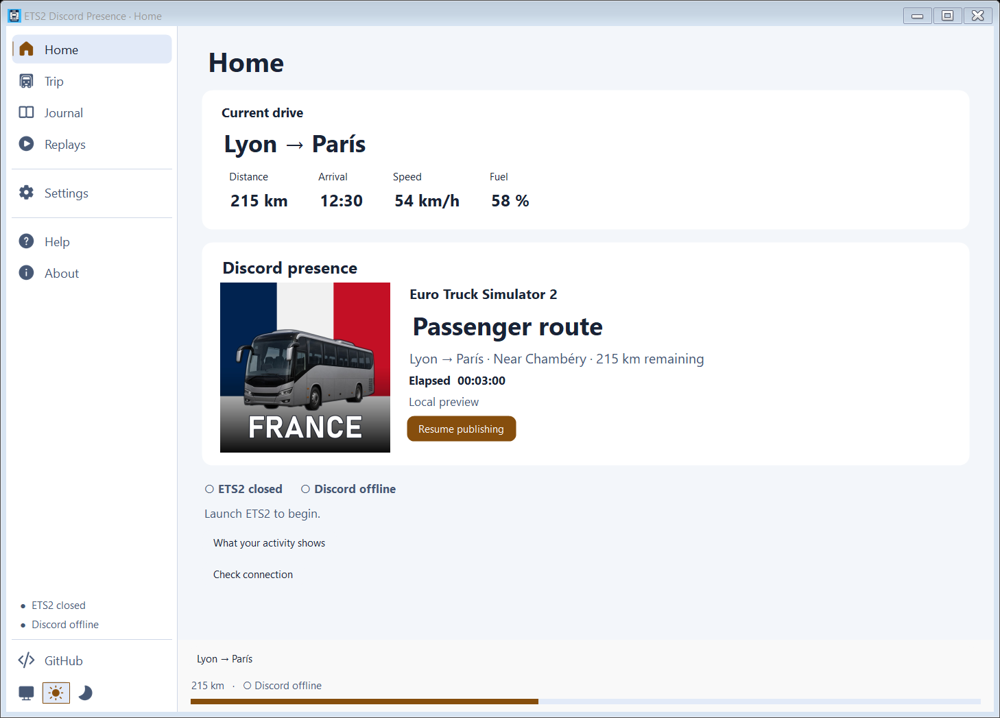
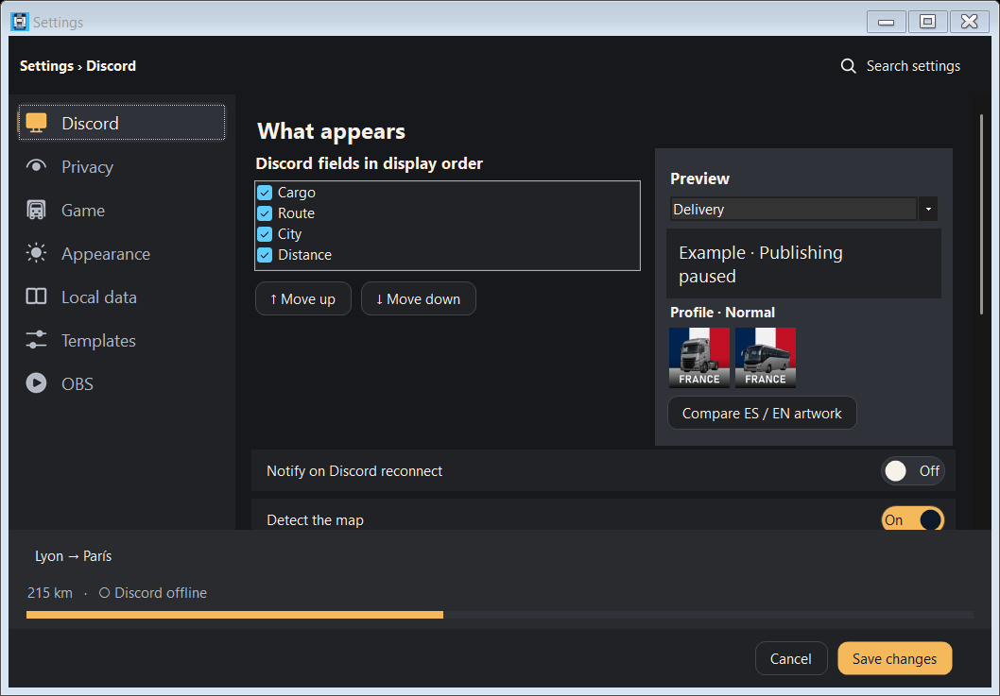

<p align="center">
  
</p>

# ETS2 Discord Presence

**Share your Euro Truck Simulator 2 journey on Discord.** Delivery routes, cargo, remaining distance and country artwork, with a Windows dashboard for your trips.

**English** · [Español](docs/README.es.md)



[](https://github.com/JesusCenMon/ETS2-Discord-Presence/releases/latest/download/ETS2DiscordPresence.exe)
[](https://github.com/JesusCenMon/ETS2-Discord-Presence/releases/latest)
[](https://github.com/JesusCenMon/ETS2-Discord-Presence/actions/workflows/ci.yml)
[](LICENSE)

[Get started](#get-started) · [Screenshots](#screenshots) · [Features](#features) · [Troubleshooting](#troubleshooting) · [Contribute](CONTRIBUTING.md)

## Get started

### Windows may show an unrecognized-app warning

Windows may display **“Windows protected your PC”** or **“Unknown publisher”** when you open the app. The current release has **no publisher digital signature**. SmartScreen checks signing and download reputation, so this prompt can appear for an unsigned community app. [Microsoft explains how this works](https://learn.microsoft.com/en-us/windows/apps/package-and-deploy/smartscreen-reputation).

Download from **JesusCenMon/ETS2-Discord-Presence → Releases** and check that the file is named **ETS2DiscordPresence.exe**. The release notes include a SHA-256 checksum to confirm it matches the published file.

Keep Windows security enabled. If your antivirus names a specific threat, stop and report the exact message through the [bug report form](https://github.com/JesusCenMon/ETS2-Discord-Presence/issues/new/choose).

1. **[Download ETS2DiscordPresence.exe](https://github.com/JesusCenMon/ETS2-Discord-Presence/releases/latest/download/ETS2DiscordPresence.exe)** and open it.
2. Open **Discord desktop** and **Euro Truck Simulator 2**.
3. Load a profile and start driving. The app finds the Steam installation and prepares the bundled telemetry readers automatically.

**One executable. No separate .NET or plugin download.** Keep the app running while you play. You can minimize it to the Windows notification area.

If ETS2 was already running during the first setup, restart the game to load its reader. Accept the SDK notice if ETS2 displays one. If Windows prevents writing to the game folder, follow the app's setup message.

| Requirement | Supported setup |
| --- | --- |
| Operating system | Windows 10 version 2004 or newer, or Windows 11, 64-bit |
| Game | Euro Truck Simulator 2 on Steam, 64-bit |
| Discord | Desktop client with activity sharing enabled |
| Languages | English and Spanish, independently selectable for the app and Discord |
| Distribution | GitHub release, with the runtime and readers included |

On a fresh setup the app uses Spanish for Spanish-language Windows and English for other Windows languages. Change the interface language in **Settings → Appearance**, and the activity language in **Settings → Discord**.

## Screenshots

Actual application screens with **local demonstration data**. Country, route and vehicle information depend on what ETS2 shares and your privacy settings.



<details>
<summary>See Home, the light theme and Settings</summary>

**Home**



**Light theme**



**Settings**



</details>

## Features

| While you play | What the app adds |
| --- | --- |
| Delivering cargo | Cargo, origin, destination, remaining distance and estimated arrival when available |
| Driving freely | Free driving status with the estimated country |
| Crossing countries | Country artwork with a flag and localized country name |
| Driving a coach | Matching coach artwork and passenger route information when available |
| Browsing your trips | A persistent Current Trip bar that opens the trip dashboard |
| Finishing a journey | A local journal with filters, favorites, comparisons and CSV export |
| Recording a drive | Local replays with a timeline, speed graph, events and markers |
| Streaming | A local OBS browser source with configurable route information |
| Taking a break | Pause sharing, hide location or choose a privacy shortcut |

Country covers follow a common style for trucks and coaches.

| France · Truck | Germany · Truck | Iceland · Truck | France · Coach |
| --- | --- | --- | --- |
|  |  |  |  |

The activity title in Discord is **Euro Truck Simulator 2**. The app includes dark, light and system themes, configurable accents, text scaling, a compact layout and reduced motion.

### Map and photo mode

Automatic map and photo recognition is **experimental**. It reads visible screen text locally and can depend on the game's language, display mode and UI layout. Enable or disable each detector in Discord settings. The tray menu also lets you choose an activity manually.

Nearby cities and countries are **estimates** from the included catalog. Unsupported maps, sparse coverage and borders can affect the result. You can import a custom city catalog in Game settings.

## Latest release · v0.9.1

- Clearer Home with a visible demo/replay notice and no duplicated trip footer.
- Protected Settings drafts: keep editing, discard, or save and continue to your chosen section.
- Undo edits per Settings section, inline save errors and discoverable advanced actions.
- Journal detail pane without losing your list, clearer selection and full-text hints.
- Replay transport stays visible while scrolling; playback states distinguish paused and finished.
- Buffered page surfaces, grouped layout updates, interaction-aware refresh and stale-data labels.
- Responsive Settings actions, image sizing and compact notices with large text.
- Includes the performance, diagnostics and background-loading improvements prepared for v0.9.0.

See the [changelog](CHANGELOG.md), [50 visual/UX refinements](docs/QUALITY-0.9.1.md) and [performance foundation](docs/QUALITY-0.9.0.md).

## Troubleshooting

<details>
<summary>Discord is open, but the activity does not appear</summary>

Use Discord's desktop application and enable activity sharing in Discord settings. Load a game profile, check the connection status in the app, and make sure publication is enabled. A local demonstration or replay pauses live sharing. Discord can also display its own detected game activity alongside Rich Presence.

</details>

<details>
<summary>The app is waiting for ETS2 data</summary>

Load a profile. If you opened the app for the first time while ETS2 was already running, restart ETS2 and accept its SDK notice if shown. Use **Locate ETS2** if the Steam library was not found. Reader checks and repair are in **Settings → Game**.

</details>

<details>
<summary>The country, city or cover is missing</summary>

Check that sharing the country and activity image is enabled. Location is estimated from the city catalog and may be omitted near borders or outside coverage. The app has truck and coach covers in English and Spanish. Customized maps may need an imported catalog.

</details>

<details>
<summary>How do I update or keep a backup?</summary>

The app checks GitHub releases. You can use its update action, or close the app and replace the executable with the latest download. Back up your settings and journal in **Settings → Local data**. Portable mode keeps data in an adjacent `ETS2PresenceData` folder after restart.

</details>

<details>
<summary>Can I install it through Steam Workshop?</summary>

Download the Windows app from GitHub. A Workshop subscription cannot prepare and run this external Discord companion on its own.

</details>

Still stuck? [Ask for help](https://github.com/JesusCenMon/ETS2-Discord-Presence/discussions) or [report a reproducible bug](https://github.com/JesusCenMon/ETS2-Discord-Presence/issues/new/choose). English and Spanish are welcome.

## Privacy

Telemetry, journals, recordings and screen recognition are processed on your computer. Chosen activity information is sent to the local Discord client for publication. Update checks contact GitHub, and activity artwork may be fetched from GitHub. OBS uses a local address while enabled.

Use privacy settings to control country, city, route and activity sharing. Before attaching logs or recordings to a public issue, remove private paths, usernames and location data you do not want to share.

## Build and contribute

Developers need Windows and the **.NET 10 SDK**. Players can use the release executable directly.

```powershell
git clone https://github.com/JesusCenMon/ETS2-Discord-Presence.git
cd ETS2-Discord-Presence
dotnet test tests/Ets2DiscordPresence.Tests/Ets2DiscordPresence.Tests.csproj -c Release
./scripts/build-release.ps1 -Tag v0.9.1
```

The script runs the existing tests, publishes a self-contained executable to `dist/standalone` and checks its bundled resources. See [CONTRIBUTING](CONTRIBUTING.md) for development, translation and release checks.

Useful contributions include reproducible bug reports, English/Spanish wording improvements, city catalog corrections and screenshots from different Windows display scales. If the app helps your driving sessions, a star or a link shared with your trucking community helps others find it.

## Credits and license

Created by **[JesusCenMon](https://github.com/JesusCenMon)**. Released under the [MIT license](LICENSE). This is an independent community project.

Includes [RenCloud's SCS telemetry plugin](https://github.com/RenCloud/scs-sdk-plugin/releases/tag/V.1.12.1), Microsoft [Fluent UI System Icons](https://github.com/microsoft/fluentui-system-icons), SCS SDK components, city data from [Koenvh1](https://github.com/Koenvh1/ETS2-City-Coordinate-Retriever) and [Trucker Mudgeon](https://github.com/truckermudgeon/truckermudgeon.github.io), and country flags from [Flagpedia](https://flagpedia.net/download). See [third-party notices](docs/THIRD_PARTY_NOTICES.md).

Euro Truck Simulator 2, Steam and Discord belong to their respective owners. Artwork is illustrative. This project is not affiliated with SCS Software, Valve or Discord.
