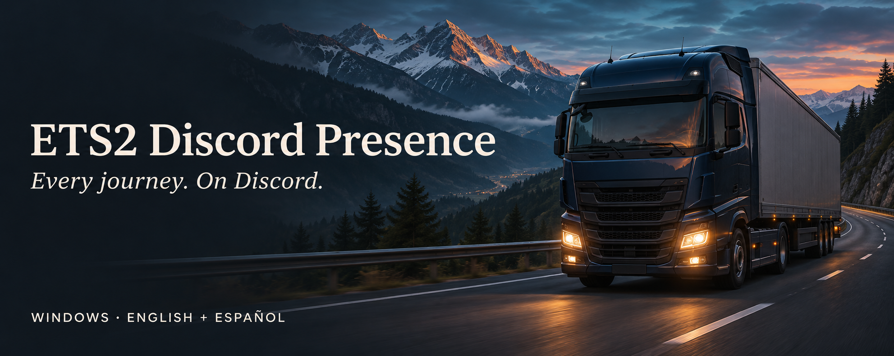
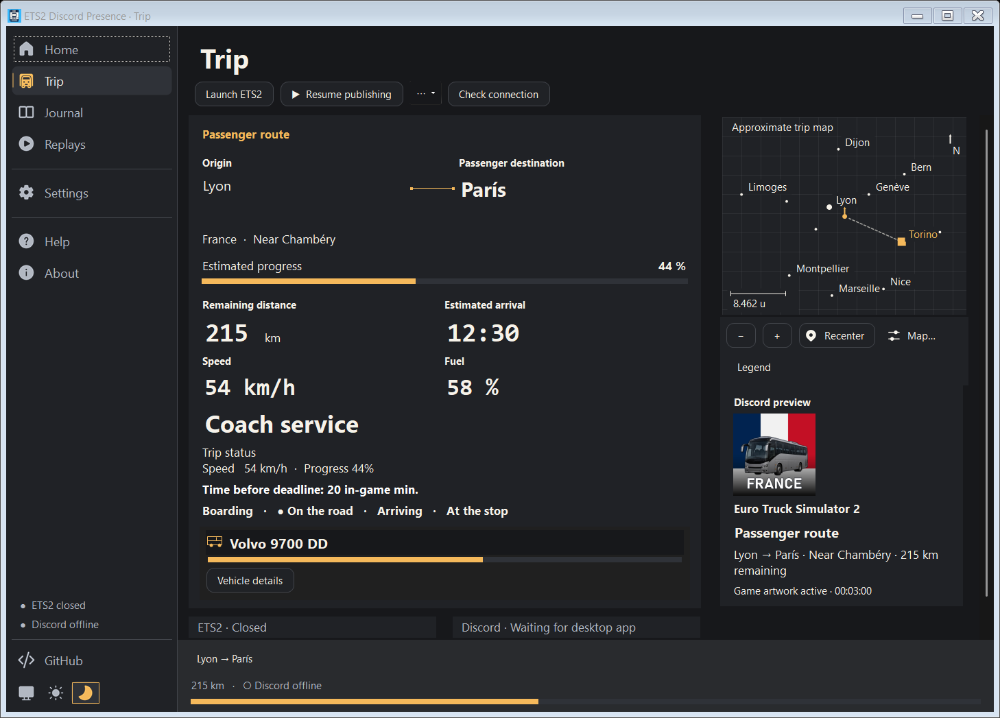

# ETS2 Discord Presence · Guía en español

[English](../README.md) · **Español**



**[Descargar para Windows](https://github.com/JesusCenMon/ETS2-Discord-Presence/releases/latest/download/ETS2DiscordPresence.exe)** · [Historial de versiones](CHANGELOG.es.md)

Muestra en Discord qué estás haciendo en **Euro Truck Simulator 2**: entrega, ciudades de origen y destino, distancia restante y, cuando se puede estimar, una ciudad cercana. Si no tienes una entrega, muestra «Explorando libremente» y, cuando la ubicación se puede estimar, «Conduciendo por España», «Conduciendo por Francia» o el país correspondiente.

## Instalar en Windows

### Posible aviso de Windows al abrir la app

Windows puede mostrar **«Windows protegió su PC»** o **«Editor desconocido»** al abrirla. Esta versión todavía **no tiene una firma digital de editor**. SmartScreen revisa la firma y la reputación de las descargas, por lo que este aviso puede aparecer con una app independiente sin firma. [Microsoft explica cómo funciona](https://learn.microsoft.com/es-es/windows/apps/package-and-deploy/smartscreen-reputation).

Descarga desde **JesusCenMon/ETS2-Discord-Presence → Releases** y comprueba que el archivo se llame **ETS2DiscordPresence.exe**. Las notas de la versión incluyen una huella SHA-256 para comprobar que coincide con el archivo publicado.

Mantén activada la protección de Windows. Si tu antivirus identifica una amenaza concreta, detente y comparte el mensaje exacto en el [formulario de errores](https://github.com/JesusCenMon/ETS2-Discord-Presence/issues/new/choose).

Windows 10 de 64 bits (versión 2004 o posterior) o Windows 11. El ejecutable incluye .NET y los lectores del juego. No necesitas descargar dependencias por separado.

En el primer inicio, la app elige español si Windows está en español e inglés para los demás idiomas. Puedes elegir por separado el idioma del panel y de Discord en **Ajustes**.

1. Descarga `ETS2DiscordPresence.exe` desde [Releases](https://github.com/JesusCenMon/ETS2-Discord-Presence/releases) y ábrelo directamente.
2. Abre Discord de escritorio y ETS2. La aplicación encuentra el juego en Steam y prepara la conexión automáticamente.

Puedes minimizar la aplicación y recuperarla desde el icono junto al reloj. Si ETS2 ya estaba abierto durante la primera preparación, reinícialo para que empiece a enviar los datos. Acepta el aviso de SDK si ETS2 lo muestra. Si Windows protege la carpeta del juego, la app te indica cómo continuar.

**Aviso:** esta aplicación se distribuye por GitHub. Los mods de ETS2 en Steam Workshop no pueden instalar y ejecutar por sí solos el componente que lee el juego. No es un mod de suscripción automática.

## Vista del panel



Captura de la aplicación con datos de demostración y la interfaz en inglés.

## Qué muestra

- En una entrega: carga, origen, destino y kilómetros restantes.
- Sin entrega: exploración libre.
- Ciudad cercana: una **estimación**, calculada con el catálogo incluido de ciudades del mapa base y de expansiones. En zonas sin cobertura la aplicación omite la ciudad.
- En pausa: indica que el juego está en pausa.
- El panel muestra la llegada estimada según el reloj de ETS2 y el progreso cuando el juego facilita una ruta y una distancia planificada. Un cambio de destino en el navegador del juego puede cambiar la estimación.

Desde **Ajustes** puedes abrir los ajustes para ordenar los datos de Discord y previsualizarlos, guardar un perfil de publicación, elegir el idioma del panel y de la actividad por separado y cambiar el tema. También puedes ordenar los paneles, elegir cuáles mostrar y activar la vista compacta. **Más opciones → Segundo monitor** mueve el panel a otra pantalla si hay una disponible. Usa Escape para volver a la ventana. Puedes ajustar el tamaño del texto por separado. Cambia el tema del panel desde los botones al pie de la barra lateral. Las ventanas nativas aplican la selección al volver a abrir la app.

El mapa muestra posiciones aproximadas, el destino y el recorrido observado durante la sesión. Arrastra o usa las flechas para moverlo. Usa la rueda o los botones para acercar y alejar, y pulsa «Centrar» para volver a la vista inicial. Puedes importar un catálogo de mapas modificados en **Ajustes → Juego**. El JSON debe contener una lista `citiesList` con los campos `realName`, `x` y `z`. El campo opcional `gameName` permite localizar destinos por su identificador de ETS2. Añade `country` a cada ciudad para que el catálogo personalizado pueda seleccionar las banderas. La línea hacia el destino indica la dirección aproximada.

**Diario** reúne las entregas y cancelaciones detectadas. Elige o crea un conductor para guardar sus viajes por separado. Busca por ciudad, carga, etiqueta o nota, marca favoritos y exporta el resultado a CSV. Usa Ctrl para seleccionar dos filas y compararlas. El calendario resume kilómetros, entregas y tiempo al volante por semana. Las horas al volante se calculan a partir de las muestras observadas.

**Repeticiones** permite grabar y borrar viajes locales o abrir un archivo JSONL anterior. Usa la línea de tiempo o el gráfico de velocidad para avanzar o retroceder. Puedes cambiar la velocidad y saltar a los eventos de recogida, ferry o entrega que se hayan detectado. Durante la reproducción se pausa la publicación en Discord.

En **Ajustes → Juego** puedes comprobar la versión y compatibilidad del lector por separado, repararlo o retirarlo con ETS2 cerrado, y activar avisos de combustible bajo. Los datos del camión aparecen cuando el juego los facilita.

En **Ajustes → Datos locales** puedes crear o restaurar una copia de los diarios, ajustes y catálogos. Puedes incluir las grabaciones cerradas en una copia manual y elegir cuánto tiempo conservarlas. El modo portátil usa la carpeta `ETS2PresenceData` junto al ejecutable a partir del siguiente inicio. Al cambiar de modo puedes copiar los ajustes, diarios y catálogos antes de volver a abrir la app.

La pausa se guarda y también se controla desde la bandeja de Windows. «Ver viaje rápido» muestra el destino, la distancia y el estado de Discord. En **Ajustes → Privacidad** puedes elegir un atajo que oculta temporalmente la ruta y la ciudad en Discord. En **Más opciones → Tarjeta OBS** se abre una ventana independiente con la ruta y distancia. Puedes capturar esa ventana en OBS y aplicar un filtro de clave de color magenta si el método de captura muestra el borde transparente como un color sólido. El inicio minimizado con Windows es opcional. Si mueves el ejecutable, desactiva y vuelve a activar esa opción desde su nueva ubicación.

Al abrir la app se comprueba si hay una versión más reciente en GitHub. Las versiones de prueba aparecen con el canal Preview. Cuando hay una actualización, aparece en **Más opciones**. Si la versión trae una suma de verificación, puedes descargarla e instalarla desde la app. La versión anterior queda disponible en el mismo menú si el ejecutable está en una carpeta donde puedes escribir.

La actividad aparece como **Euro Truck Simulator 2** en Discord. La actividad usa una sola portada, con la bandera del país cuando está disponible y se permite compartirla. El temporizador cuenta desde que se detecta la actividad. Ambos se pueden desactivar desde **Ajustes → Discord**. El título oficial detectado automáticamente por Discord puede coexistir con esta actividad según la configuración del cliente.

## Problemas frecuentes

- **No aparece ETS2:** pulsa «Buscar ETS2» y selecciona la carpeta `Euro Truck Simulator 2` dentro de tu biblioteca de Steam.
- **No aparece la actividad:** abre Discord de escritorio y revisa que «Compartir mi actividad» esté activado.
- **La aplicación espera datos:** entra a una partida. Si acabas de abrir la app por primera vez con ETS2 ya iniciado, reinicia el juego y acepta su aviso de SDK si aparece.
- **Ciudad incorrecta:** la ubicación es aproximada y la lista no cubre todos los DLC ni mapas externos.
- **Lector incompatible:** sigue la indicación del panel y abre **Ajustes → Juego**. Desde ahí puedes reparar el lector propio o copiar un diagnóstico.

## Novedades

La v0.8.8 corrige pausas adicionales al cargar pestañas y agiliza la navegación, conserva las páginas de Diario y Repeticiones e integra Ajustes en la ventana principal. Añade lectura de grabaciones en segundo plano, mejoras de texto ampliado y menos trabajo de dibujo en mapas y gráficos. Consulta el [historial completo](CHANGELOG.es.md).

## Desarrollo

Requiere .NET 10 SDK en Windows.

El ID público de la aplicación registrada en Discord está en `DiscordIdentity.cs` y viene incluido en la descarga.

```powershell
dotnet test tests/Ets2DiscordPresence.Tests/Ets2DiscordPresence.Tests.csproj -c Release
./scripts/build-release.ps1
```

El script verifica la versión, el tag de los recursos de Discord y el encabezado del README. Ejecuta la suite antes de generar el ejecutable y su archivo SHA-256 en `dist/standalone`.

## Alcance y créditos

La aplicación lee los datos en el equipo y se comunica con Discord de escritorio. El ejecutable incluye el lector de la [versión V.1.12.1 de RenCloud](https://github.com/RenCloud/scs-sdk-plugin/releases/tag/V.1.12.1) y un catálogo de 414 puntos urbanos. Conserva nombres e identificadores de [ETS2-City-Coordinate-Retriever](https://github.com/Koenvh1/ETS2-City-Coordinate-Retriever) y añade posiciones y países del [mapa de Trucker Mudgeon](https://github.com/truckermudgeon/truckermudgeon.github.io/blob/559c5fa5a84189e48f637e84d79832841966a073/ets2-search.geojson). La posición del país se estima a partir de las ciudades, por lo que se omite en lugares sin cobertura o con señales ambiguas cerca de fronteras. Los catálogos personalizados pueden añadir el campo `country` con códigos como `ES` o `PT`. Sus avisos de licencia están disponibles desde el menú del icono junto al reloj.

Probado mediante compilación y pruebas automáticas; la lectura en una partida real de ETS2 y la visualización en una cuenta de Discord requieren validación en una máquina con el juego y Discord abiertos.

### Prueba con ETS2 y Discord antes de publicar

1. En Windows sin el SDK de .NET, abre el ejecutable junto con Discord de escritorio. Localiza ETS2 también desde una biblioteca de Steam secundaria.
2. Con una entrega activa, confirma desde una segunda cuenta el título, el texto, la portada y el cambio de país al cruzar una frontera.
3. Inicia una ruta de pasajeros y revisa el destino, la portada y el registro de la sesión. Comprueba que una ruta manual y una automática no se dupliquen.
4. Abre y cierra mapa y modo foto en español e inglés. Repite con juego en ventana, pantalla completa y superposición. Verifica que al volver a conducir se recupere el viaje.
5. Reinicia Discord, pausa la publicación y cierra ETS2. La actividad debe volver al reconectar y retirarse cuando dejes de compartir.
6. Actualiza desde una copia de la versión anterior y revisa que ajustes y diarios sigan intactos. Prueba la vuelta a la versión anterior.
7. Mueve la interfaz entre pantallas con escalas distintas y recorre Ajustes, Diario y Repeticiones con el teclado. Registra el resultado y los casos pendientes.
